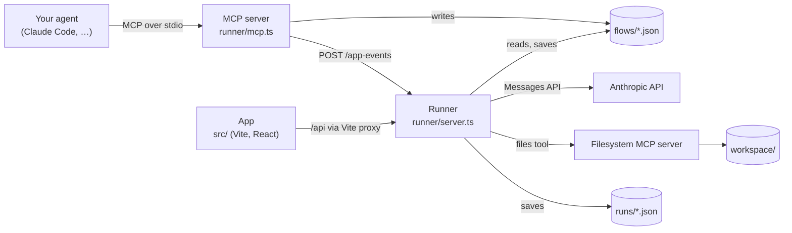
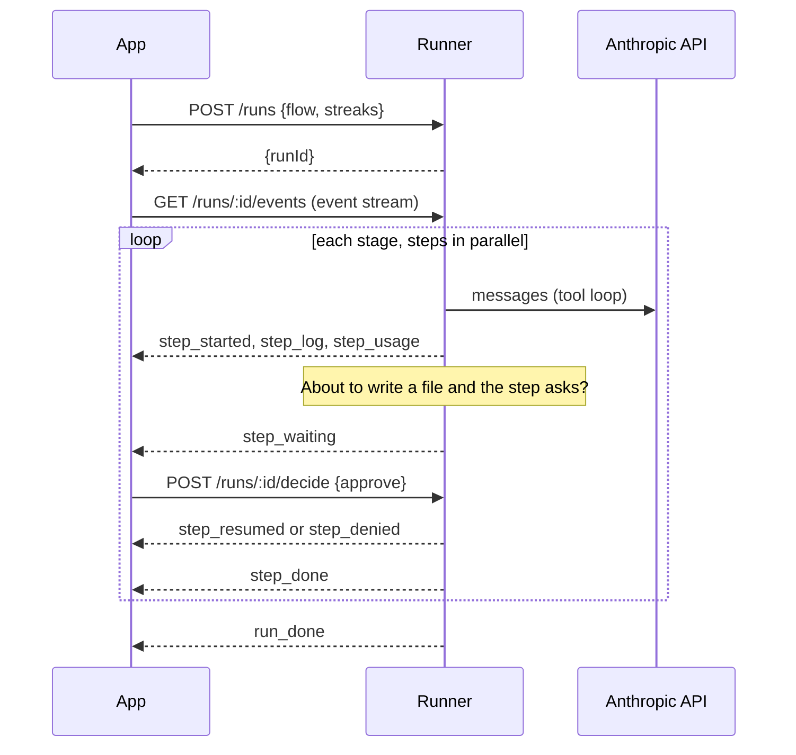

# Architecture

OpenWove is three programs that share one file format.

| Program | Started by | Job |
|---|---|---|
| **App** (`src/`) | `npm run dev` | Shows a flow on a canvas (Set up), plays or follows a run (Live), and collects your approvals. |
| **Runner** (`runner/server.ts`) | `npm run runner` | Runs flows for real: calls Claude, connects tools, pauses at approvals, saves every run. The only program that reads your API key. |
| **MCP server** (`runner/mcp.ts`) | Your agent | Lets your agent read the guide and list, read, save and open flows. Never runs flows. |

They share [`src/lib/flow-file.ts`](../src/lib/flow-file.ts), the flow format as a zod schema. It imports nothing but zod, so the app, runner, MCP server and `scripts/check-flow.ts` all check flows the same way. See [flow-format.md](flow-format.md).

## The app

- **State.** One zustand store, [`src/lib/store.ts`](../src/lib/store.ts), holds the flow, the run and the UI. It's a thin wrapper: all run logic lives in [`src/lib/engine.ts`](../src/lib/engine.ts) as pure functions (`startRun`, `tick`, `decide`, `applyRunnerEvent`, `fastForward`) that take a `Sim` and return a new one.
- **Time.** The timeline runs on a simulated clock in minutes (`simT`). An animation-frame loop calls the store's `frame`, which calls `engine.tick`. Simulated runs move 1.4 minutes per second, so a whole flow plays in about 15 seconds; real runs move at real speed.
  - The clock updates every frame only while a simulated run plays on Live. Otherwise it updates four times a second (`SLOW_FRAME_SECONDS`), which looks the same and saves a re-render per frame.
  - `tick` copies only the tasks it changes, and the timeline scrolls by sliding one track under fixed bars, so a bar that didn't change keeps its identity and props and doesn't re-render.
- **Simulated runs** are made up in the engine: each step works for its `minutes`, pauses for approval at 70% (`GATE_AT`), and spends tokens at a fixed rate for the cost estimate.
- **Real runs** are driven by the runner. The engine creates the tasks, then `applyRunnerEvent` moves them along as events arrive.
- **Views.** `src/components/setup/` is the canvas (React Flow, loaded on demand so it stays out of the first download), `src/components/live/` the timeline and tray, `src/components/shell/` the sidebar, Usage page and Settings, and `src/components/shared/` the pieces more than one view uses. Small hooks (color mode, the animation frame) live in `src/hooks/`.
- **Tuning numbers** live in [`src/lib/constants.ts`](../src/lib/constants.ts), named and explained. Model prices live in [`src/lib/models.ts`](../src/lib/models.ts).

### Ask until it's earned it

A step with `approval: "earned"` asks every time until you've approved it `EARN_AFTER` (3) times in a row. After that, each further approval multiplies the chance of asking by `ASK_DECAY` (0.6), down to `ASK_FLOOR` (10%), so it never stops asking completely. One deny resets the streak. The rule is `askChance` in the engine, and the runner uses the same function, so simulated and real runs behave alike.

This is the place a smarter policy plugs in: each approve or deny is feedback, and a decision service's answer can replace `askChance`.

## A real run, start to finish

1. **Start.** The app sends the flow and each step's approval streak. The runner checks the flow again and starts it.
2. **Stages.** Stages run in order; steps in a stage run at the same time. If a step fails or is denied, the run stops and later steps are skipped.
3. **Each step** is one Claude tool loop ([`runner/run.ts`](../runner/run.ts)): up to 24 tool calls (`MAX_TURNS`), 16,000 output tokens per reply. Earlier steps' final replies are passed along in the prompt. Each call caches its prompt, so later turns of the loop re-read the tools, system prompt and conversation from cache (cached tokens still count at the full input rate on the cost line). Calls to Opus and Sonnet opt into Anthropic's server-side fallback (`FALLBACK_MODELS`), so a reply the model declines may come from another model than the card names.
4. **Approvals.** A step that asks pauses before its first acting tool call (`write_file`, `edit_file`, `move_file`), so it can read and think freely but can't change anything until you say yes. It asks once per step: after that yes, further writes in the same step go ahead.
5. **Trouble.** An API call that hits a temporary error (rate limit, overload, no connection) is tried up to 3 times (`API_TRIES`: the first call plus two retries). If a step still can't continue, the runner sends `step_problem` and waits for you to choose **retry**, **skip** or **stop**.
6. **Events** stream to the app as server-sent events. Each carries its index as the event id, so a reconnecting browser gets only what it missed and costs aren't counted twice. The app stops listening at `run_done`.
7. **Saving.** The run is written to `runs/<id>.json` as it goes: a burst of events costs one write, beside the file and then renamed, so a crash can't leave half a file. Once it ends, the runner serves it from that record like a run from before a restart. If the runner stops mid-run, the run is closed out as interrupted when it starts again. The **Usage** page reads these files.

The app remembers the run it's following in that browser tab, so reloading the tab rejoins it. A new tab doesn't. If the runner goes away mid-run, the app says so and marks what was still going as stopped.

## Tools

Real runs support one tool, `files`. The runner starts one [filesystem MCP server](https://www.npmjs.com/package/@modelcontextprotocol/server-filesystem) process limited to `workspace/` and shares it across steps ([`runner/files-tool.ts`](../runner/files-tool.ts)). Any other tool id in a flow shows on the cards and runs in simulated mode; in a real run the step goes ahead without it and logs what was skipped.

## When your agent saves a flow

1. Your agent calls `save_flow`. The MCP server checks the flow and writes `flows/<file>.json`.
2. It tells the runner with `POST /app-events`, and the runner forwards a `flow-saved` event to every open app window.
3. The app opens the flow. If you have unsaved changes or a run going, it asks you first.

If the runner isn't running, the flow is still saved and shows under **Flows** when you open the app. The MCP server tells your agent which of these happened.

## Design rules

- The flow file is the contract. Anything that runs, shows or checks a flow goes through `parseFlow`.
- The engine stays pure: no timers, no fetches, no React. That's what keeps it testable and shared.
- The MCP server's stdout is the protocol. It must never log there.
- The API key never leaves the runner, and the MCP server never sees it.
